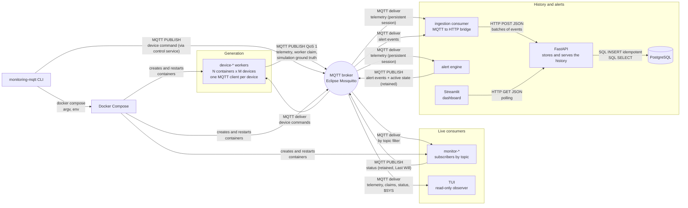
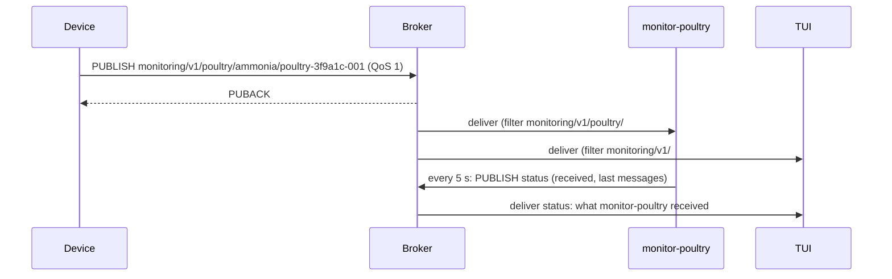
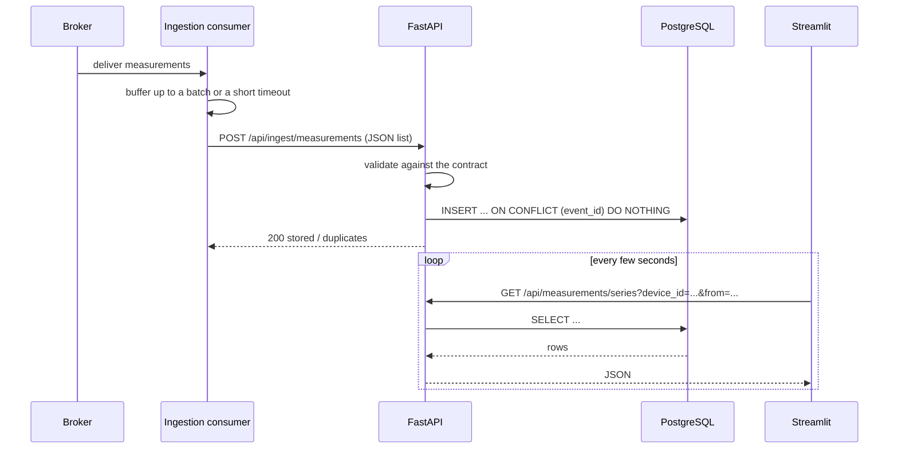
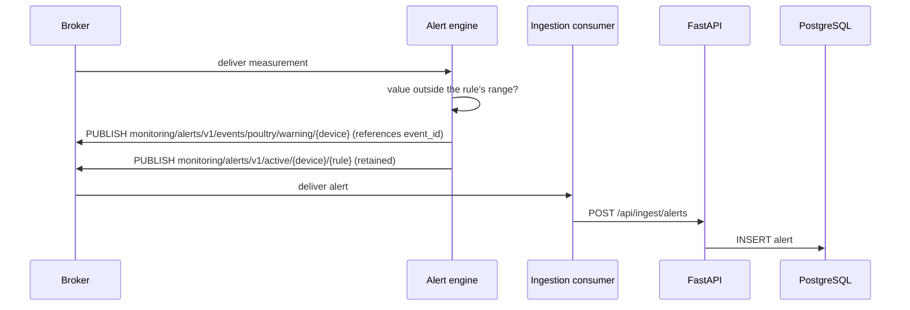
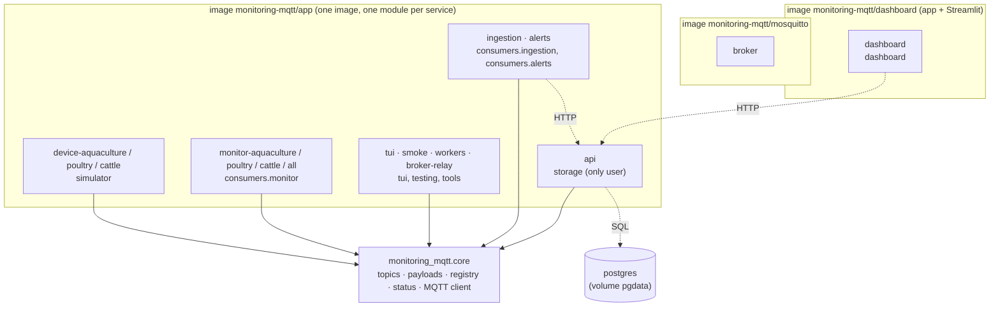

# System design

How the parts of Monitoring MQTT communicate, today and as planned. Each part is marked
**implemented** or **planned**; details of what already runs are in
[architecture.md](architecture.md) and [mqtt-contract.md](mqtt-contract.md).

## 1. Idea

Virtual IoT devices measure chemical metrics in three production domains: dissolved
oxygen in aquaculture, ammonia in poultry houses and rumen pH in cattle. They publish
every measurement to an MQTT broker, and independent consumers receive only the topics
they subscribe to. Publishers and consumers never know each other: the broker is the only
meeting point. Around this core, the project adds alerts, an API that owns the stored
history, and two interfaces, each one communicating through the mechanism that fits its
job.

## 2. Communication map

Every arrow is implemented.

The map has three kinds of communication:

| Kind | Style | Used for |
|---|---|---|
| **MQTT publish/subscribe** | Asynchronous push through the broker; many-to-many; senders and receivers are decoupled | Everything that happens *now*: telemetry, presence, coordination, alerts |
| **HTTP/REST** | Synchronous request/response | Handing events over to storage (POST) and asking about the *past*: history, alerts, experiment results (GET) |
| **SQL** | Used only by the API | Durable storage; the API is the single owner of the database |

The CLI and Docker Compose form a fourth path, the **control plane**: they start, stop
and scale containers. They are never in the data path, and the stack keeps running
without the CLI.

## 3. Who talks to whom

| From | To | Mechanism | What travels | Status |
|---|---|---|---|---|
| Device | Broker | MQTT PUBLISH, QoS 1 | `monitoring/v1/{domain}/{metric}/{device_id}`: one JSON measurement | implemented |
| Worker | Broker | MQTT retained + Last Will | `monitoring/registry/v1/workers/{id}`: claim of its worker id | implemented |
| Worker | Broker | MQTT PUBLISH, QoS 1 | `monitoring/sim/v1/devices/{device_id}`: ground truth, an episode started or ended | implemented |
| CLI (`control` service) | Worker | MQTT PUBLISH, QoS 1, via broker | `monitoring/control/v1/workers/{id}/devices/{device_id}`: live command; the worker acknowledges on `…/acks/{request_id}` | implemented |
| Broker | Monitors | MQTT delivery | Telemetry matching each monitor's filter, e.g. `monitoring/v1/poultry/#` | implemented |
| Monitor | Broker | MQTT retained + Last Will | `monitoring/status/v1/monitors/{client_id}`: filter, counters, last messages received | implemented |
| Broker | TUI | MQTT delivery | Telemetry, worker claims, monitor status, simulation ground truth, `$SYS` broker statistics | implemented |
| Broker | Ingestion consumer | MQTT delivery, persistent session | All telemetry (`monitoring/v1/#`) and alert events (`monitoring/alerts/v1/events/#`) | implemented |
| Ingestion consumer | FastAPI | HTTP POST, JSON | Batches of measurements and alerts to store (`/api/ingest/...`) | implemented |
| FastAPI | PostgreSQL | SQL (write) | Measurements and alerts; duplicates dropped by `event_id` / alert transition | implemented |
| Broker | Alert engine | MQTT delivery, persistent session | Telemetry to check against rules | implemented |
| Alert engine | Broker | MQTT PUBLISH | `monitoring/alerts/v1/events/{domain}/{severity}/{device_id}`: derived event that references the measurement; `…/active/{device_id}/{rule_id}` retained | implemented |
| FastAPI | PostgreSQL | SQL (read) | Devices, measurements, series, alerts, runs | implemented |
| Streamlit | FastAPI | HTTP GET, JSON | Query results for charts and tables (`/api/...`, including the catalog of device types and alert rules) | implemented |
| CLI | Docker Compose | Process call | Service list, replicas and experiment variables | implemented |

## 4. Components

| Component | Runs as | Module | Role | Status |
|---|---|---|---|---|
| Virtual device | inside `device-{domain}` | `simulator.device` | Generates a measurement and publishes it over its own MQTT connection | implemented |
| Worker | `device-{domain}` (N replicas) | `simulator.worker` | Hosts M devices, schedules their publications, claims its id | implemented |
| Broker | `broker` | Mosquitto (no project code) | Routes messages by topic; keeps retained messages; runs Last Wills | implemented |
| Monitor | `monitor-{kind}` (N replicas) | `consumers.monitor` | Subscribes to a filter, validates, counts, reports its status | implemented |
| TUI | `tui` (one-off) | `tui` | Shows who publishes, the broker and what each consumer received | implemented |
| Ingestion consumer | `ingestion` | `consumers.ingestion` | Subscribes to telemetry and alerts and hands them to the API in batches; never touches the database | implemented |
| Alert engine | `alerts` | `consumers.alerts` | Applies threshold rules and publishes alert events | implemented |
| Database | `postgres` | PostgreSQL + SQLAlchemy/Alembic | Durable history, owned by the API | implemented |
| API | `api` | `api` (FastAPI) | Single entry point to the database: receives events to store and answers queries | implemented |
| Dashboard | `dashboard` | `dashboard` (Streamlit) | Historical charts, alerts and run comparison, read from the API | implemented |
| CLI | host or Dev Container | `cli` | Applies the experiment and machine settings to Compose | implemented |
| Relay | `broker-relay` (optional) | `tools.relay` | Lets containers reach a broker tunnel on the host's loopback | implemented |

Shared contract: every component that speaks MQTT builds and validates topics and payloads
with `monitoring_mqtt.core`. No other package is shared, so components can change
independently.

## 5. Mechanisms

### MQTT: the event backbone

- **Pattern.** Publish/subscribe through one broker. A publisher sends to a topic; the
  broker forwards a copy to every subscriber whose filter matches (`+` matches one level,
  `#` the rest). Several subscribers on the same filter each get a copy (fan-out).
- **Delivery.** QoS 1: at least once, so duplicates are possible. Consumers that store
  data deduplicate by `event_id`.
- **Presence and coordination.** Retained messages keep the latest state of a topic for
  newcomers; a Last Will lets the broker announce a client that disappears. Workers use
  them to claim unique ids, monitors to announce their status.
- **Why MQTT.** Lightweight, designed for many small devices, topic-based filtering in
  the broker, and no direct link between producers and consumers.

### HTTP/REST: the API owns the data

- **FastAPI is the only component that talks to the database.** Everything that is stored
  enters through it, and everything that is read leaves through it, so the schema, the
  validation and the deduplication live in one place.
- **Write side.** The ingestion consumer receives events from the broker and sends them to
  the API in batches: `POST /api/ingest/measurements` and `POST /api/ingest/alerts` with a JSON
  list. The API validates each event against the same contract as the monitors and stores
  it once (see SQL below). Batches keep the number of HTTP requests low when hundreds of
  devices publish.
- **Read side.** JSON queries over the history: `GET /api/devices`,
  `GET /api/measurements?device_id=…&from=…&to=…`, `GET /api/measurements/series`, `GET /api/alerts`,
  `GET /api/runs`, `GET /api/stats`, plus `GET /health` and `GET /ready`. The API publishes its
  OpenAPI description, with a Scalar reference at `/docs` ([api.md](api.md)).
- **Why a bridge instead of letting the API subscribe.** The API stays a plain HTTP
  service that can be restarted, scaled or tested without the broker, and the MQTT side
  stays in the consumers. The bridge is the only place where the two worlds meet.
- **When the API is down.** The ingestion consumer keeps receiving MQTT messages and
  holds them in a bounded buffer, retrying with backoff. If the buffer fills up, the
  oldest events are dropped and counted; sequence gaps in the stored data show it.

### Streamlit: how the dashboard gets its data

> **What Streamlit is.** A Python library that turns a script into a web dashboard
> (charts, tables, filters) without HTML or JavaScript. It runs as a small web server
> (port 8501), and the script runs again from top to bottom every time the user changes a
> filter.

- The dashboard **pulls** data from the API over HTTP. Charts refresh on a timer
  (`st.fragment(run_every=…)`), and responses are cached for a few seconds
  (`st.cache_data(ttl=…)`) so that many viewers do not overload the API
  ([dashboard.md](dashboard.md)).
- What it draws besides the data (normal bands, alert thresholds) also comes from the
  API (`GET /api/catalog`), so it reads no configuration file.
- It never subscribes to MQTT and never opens the database. If the dashboard is down,
  nothing else is affected.
- **Live versus history.** The TUI is pushed every event by the broker and shows what
  happens now. Streamlit pulls stored data and shows what happened. Together they show
  both communication styles of the system.

### SQL: storage behind the API

- Only the API opens database connections (SQLAlchemy, schema migrations with Alembic).
- Tables: `runs`, `devices`, `measurements` (unique `event_id`), `alerts`
  ([storage.md](storage.md)); experiment metrics come with the experiment runner. Event
  time, reception time and storage time are kept apart.
- `INSERT … ON CONFLICT (event_id) DO NOTHING` makes storage idempotent: an event that
  arrives twice (QoS 1 duplicate, or a batch retried after a timeout) becomes one row.

## 6. Key flows

**Live telemetry** (implemented)

**Storage and history** (implemented)

**Alerts** (implemented)

## 7. Containers and modules

- **One application image**, one Python module per service; Compose only changes the
  command and the environment. The broker has its own image, and so does the dashboard:
  Streamlit and its data libraries would add hundreds of megabytes to the image every
  device container (and Raspberry Pi) runs.
- **Module rule:** `core` depends on nothing in the project; `simulator`, `consumers`,
  `tui`, `tools` and `dashboard` depend only on `core` (the TUI, the control tool and the
  API also read the device catalog from `simulator`); only `api` uses `storage`; the CLI
  is the only part that knows about Docker. A unit test checks these rules.
- **Ports on the host** (loopback by default): broker `1883`, API `8000`, dashboard
  `8501`.

## 8. Orchestration

- **`monitoring-mqtt stack up`** reads the experiment (`config/simulation.yaml`: QoS,
  interval, replicas N, devices per container M, monitors) and the machine settings
  (`.env`: roles, broker address, machine name), then runs `docker compose up --wait` and
  checks the result.
- **Compose** starts the broker first (healthcheck), then the services; restarts them if
  they fail; scales them with `deploy.replicas`. One-off tools (`tui`, `smoke`,
  `workers`) run under the `tools` profile.
- **Several machines.** `STACK_ROLES` splits the stack, for example the broker on a
  Raspberry Pi and devices on other computers ([distributed.md](distributed.md)). The
  storage (PostgreSQL, API, ingestion), the alert engine and the dashboard are the roles
  `storage`, `alerts` and `dashboard`.

## 9. Guarantees and limits

| Topic | Behaviour |
|---|---|
| Decoupling | Publishers and consumers share only the broker address and the contract; devices publish with zero consumers |
| Delivery | QoS 1, at least once; the API removes duplicates by `event_id` when it stores data |
| Time decoupling | Limited: with clean sessions, a consumer only receives what is published while it is connected. History comes from the storage path (ingestion consumer → API → database) |
| Failures | Clients reconnect on their own; Last Wills announce lost workers and monitors; sequence gaps reveal lost messages |
| Single point of failure | One broker: when it stops, no messages flow until it returns |
| Clocks | Cross-machine latency needs synchronized clocks (NTP) |
| Security | Anonymous broker, isolated lab network only |
